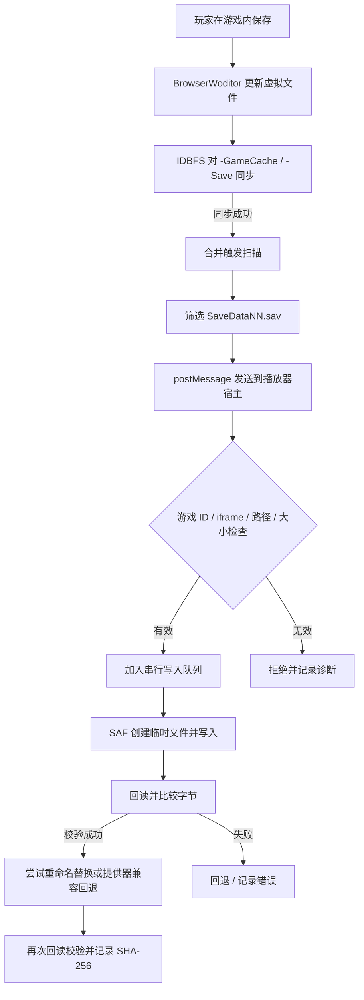

# Android WOLF RPG 外部存档持久化

本文说明 AetherPlay 怎样把 BrowserWoditor 的虚拟存档同步回玩家选中的 Android 游戏目录，以及当前实现的适用范围。

## 目标与问题

BrowserWoditor 使用 Emscripten 虚拟文件系统，并把部分可写数据挂载到 IDBFS/IndexedDB。仅仅确认 IDBFS 同步成功，不能说明 Android 共享存储中的游戏目录已被写入。AetherPlay 因此把“虚拟存档已持久化”和“外部文件已更新”作为两个独立阶段记录。

另一个 Android 特有的问题是目录名称大小写。游戏目录可能已有小写 `save/`，而运行时请求路径写作 `Save/`。若通过 SAF 查询时使用区分大小写的名称比较，查找就会失败；接着请求创建 `Save` 时，文档提供器可能产生 `Save (1)` 等名称。即使字节写入成功，存档也会被分散到多个目录。

## 数据路径

玩家可见的文件通常位于：

```text
<选定游戏目录>/save/SaveData01.sav
<选定游戏目录>/save/SaveData02.sav
...
```

现有目录和文件实际大小写可不同。实现通过 SAF 子项查找忽略名称大小写来复用已存在目录和文件，而不是强行创建一个大小写不同的目录。

BrowserWoditor 的虚拟存储则可能包含：

```text
/data0/<projectId>-GameCache/Save/SaveDataNN.sav
/data0/<projectId>-Save/Save/SaveDataNN.sav
```

运行时会扫描两个挂载位置，因为游戏可能同时更新 `-GameCache` 与 `-Save`。若同一槽位在两处都存在，当前策略优先选择 `-GameCache` 中运行时正在使用的副本。

## 写入流程



### 1. 注册 SAF 根目录

播放器从游戏目录授权中取得 tree URI，并按当前 `gameId` 注册外部存档根目录。注册成功会产生 `wolf.save.external-root.registered`。如果注册失败，游戏仍可启动，但不能据此认定外部存档桥接可用。

### 2. 加载外部存档

运行时在访问 WOLF 存档路径时，通过内部 `/__save__/` 路由请求外部文件。原生层只允许受限的存档相对路径，避免把任意用户输入转换成文件系统路径。已读取的内容再进入 BrowserWoditor 虚拟文件系统。

### 3. Hook IDBFS 的实际挂载

BrowserWoditor 在初始化期间创建 IDBFS 挂载，所以只在较早时刻枚举一次 `FS.mounts` 不够可靠。运行时需要拦截 `FS.mount`，在挂载创建后安装该挂载的 `type.syncfs` 回调。

仅在 `populate=false` 且回调成功的写入同步后安排扫描；初始化时的 populate 操作不应该触发对外写回。多个同步事件通过短暂合并窗口收敛为一次扫描，减少重复写入。

### 4. 约束扫描内容

- 只接收符合 `SaveData\d+\.sav` 的槽位文件。
- 扫描 `-GameCache/Save` 和 `-Save/Save` 两个位置。
- 跳过 0 字节文件，避免保存操作期间的临时空槽覆盖正常存档。
- 跳过超过 16 MiB 的文件。
- 按槽位去重，优先使用 `-GameCache` 运行时副本。
- 以长度和内容指纹去重，不对未变化的槽位反复发送。

### 5. 宿主消息验证

宿主只处理来自当前游戏 iframe 且 `gameId` 与当前活动游戏一致的消息。路径必须是 `Save/SaveDataNN.sav` 形式；字节必须非空且不能超过 16 MiB。通过校验的写入进入串行队列，避免多槽同时写文件造成竞态。

### 6. SAF 可靠写入

原生插件查找或创建已有 `save` 目录，创建临时文件，写入待保存字节并回读比较。随后尝试重命名替换；如果文档提供器不支持重命名，则使用受控的直接写入回退。最终目标文件还会再次回读比较。日志包含字节数及 SHA-256，便于与预期数据比对。

名称查找必须不区分大小写。对于已经存在的 `save/`，请求中的 `Save/` 应解析到同一个目录；同样地，`savedata01.sav` 与 `SaveData01.sav` 应解析到已有文件，而不再创建 `Save (1)` 或第二份同名文件。

## 关键诊断事件

| 日志事件 | 含义 |
|---|---|
| `wolf.save.external-root.registered` | 外部游戏目录授权已注册 |
| `wolf.save.writeback.writeback_hook_installed` | 运行时已安装存档写回钩子 |
| `wolf.save.writeback.mount_created` | 发现并拦截新的目标 IDBFS 挂载 |
| `wolf.save.writeback.mount_hooked` | 已为挂载安装 `syncfs` 钩子 |
| `wolf.save.writeback.idbfs_sync_done` | 该 IDBFS 挂载的写入同步成功 |
| `wolf.save.writeback.scan_complete` | 扫描结束，`candidates` 表示找到的不同槽位数 |
| `wolf.save.writeback.save_publish` | 某个有效槽位已发送给宿主 |
| `wolf.save.external-write.completed` | 原生外部文件写入与校验完成 |
| `wolf.save.external-write.failed` | 原生写入失败，需查看附带错误 |

`scan_complete` 的候选数大于 0 只说明在虚拟文件系统中找到了槽位；最终要以对应路径的 `wolf.save.external-write.completed` 作为外部写回完成的证据。若目标槽位没有出现 `save_publish`，应先排查虚拟目录和文件名；如果发布了但没有 `external-write.completed`，再检查宿主验证、SAF 授权或原生写入错误。

## 当前验证记录与限制

- `pnpm build` 已成功完成 TypeScript 检查和 Vite 生产构建。
- `npx cap sync android` 已成功同步 Android Web 资源。
- Android 实机日志观察到 `SaveData01`、`SaveData02`、`SaveData03`、`SaveData04`、`SaveData99` 的 `wolf.save.external-write.completed`，并记录每个文件的字节数与 SHA-256。
- 手动检查确认修复后保存会更新已有 `save` 目录，而不再新建 `Save (1)` 等额外目录。
- 上述日志中没有观测到 `SaveData09.sav` 的完成事件，因此不要把槽位 09 视作已单独验证；需要时应另行保存并检查该槽位。

这不是一个任意目录同步服务：当前允许的外部写回范围是 `Save/SaveDataNN.sav`。IDBFS 仍由 BrowserWoditor 使用，AetherPlay 的职责是围绕它做安全、有约束、可诊断的 Android 外部存档桥接。
